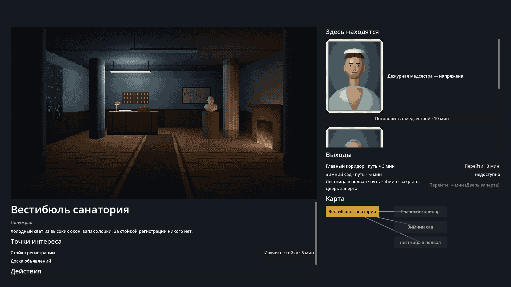
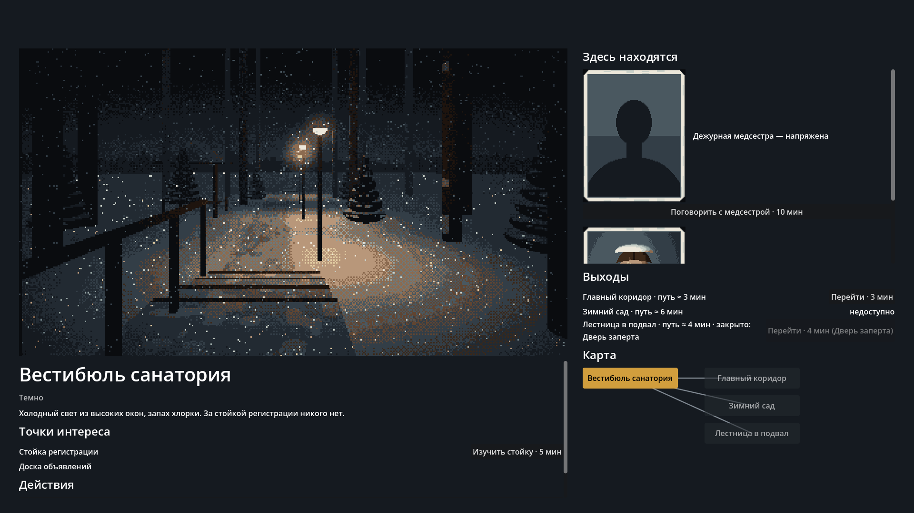
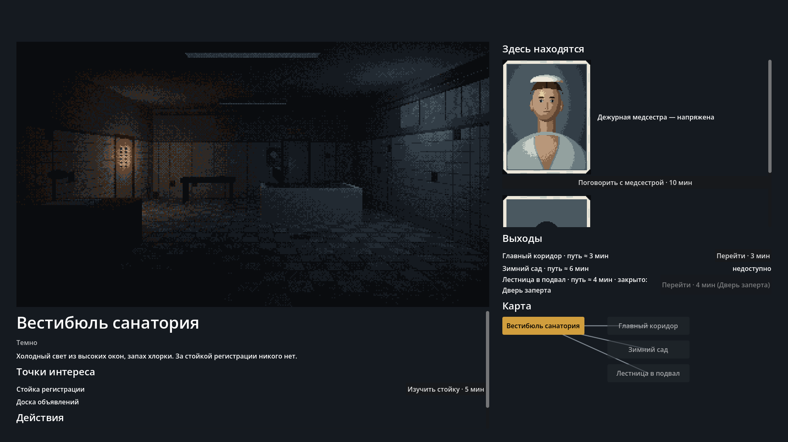
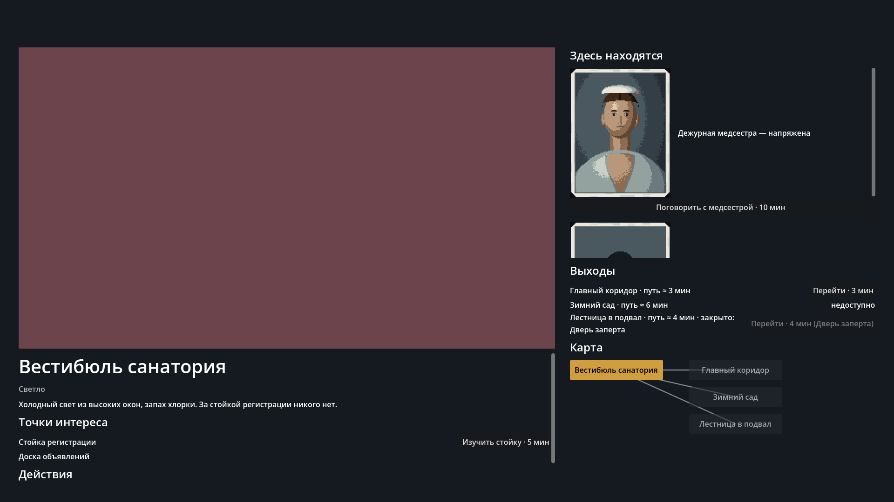

# Godot Desktop Client (`apps/desktop`)

Стек — [ADR 0011](../architecture/adr/0011-godot-client-stack.md). Роль — [ADR 0002](../architecture/adr/0002-headless-game-core.md).

## 1. Ответственность

Godot отвечает за **игровой опыт**: отрисовку локаций, персонажей, предметов и улик; интерфейс
(доска дела, диалоги, HUD, обвинение, концовки); ввод; аудио; визуальные хоррор-эффекты;
показ QR привязки и QR улик; запуск локального сервера в релизе.

Godot **не** содержит игровых правил: не вычисляет стоимость действий, исходы, знания NPC.
Всё это приходит в `PlayerView`. Разрешено: визуальная интерпретация уже полученных значений
(искажение экрана по `sanity`, звук по `static`).

## 2. Структура проекта

```
apps/desktop/
├── project.godot                 — Godot 4.7; autoload; строгие предупреждения GDScript
├── addons/gut/                   — GUT 9.7.x (вендорено)
├── src/
│   ├── autoload/
│   │   ├── backend.gd            — Backend: REST (HTTPRequest) + WS (WebSocketPeer), очередь запросов, reconnect
│   │   ├── game_store.gd         — GameStore: текущий PlayerView, сигналы view_changed, event_received, peer_status_changed, action_failed
│   │   ├── scene_router.gd       — SceneRouter: переходы между экранами через затемнение
│   │   ├── settings.gd           — Settings: настройки игрока (ConfigFile user://); пока — «Снизить визуальные эффекты» (§7.1)
│   │   ├── audio_director.gd     — AudioDirector: эмбиент по локации/периоду, стингеры (§7.3)
│   │   └── server_launcher.gd    — ServerLauncher: запуск встроенного сервера в релизе (INT-005)
│   ├── net/
│   │   ├── protocol_constants.gd — ProtocolConstants, СГЕНЕРИРОВАНО из @hs/protocol (не редактировать)
│   │   ├── envelope.gd           — сборка/разбор конверта
│   │   └── reconnect_policy.gd   — экспоненциальная задержка
│   ├── util/
│   │   └── read_only.gd          — глубокие read-only копии данных для экранов
│   ├── scenes/
│   │   ├── bootstrap.tscn        — стартовая сцена: версия клиента, оверлеи, переход на NewGame
│   │   ├── main_menu/  new_game/  pairing/  exploration/  dialogue/
│   │   ├── case_board/  accusation/  ending/  hud/  overlays/ (evidence_capture, horror_fx, phone_status)
│   │   ├── exploration/          — экран Exploration и загрузчик фикстур для предпросмотра (§4.1)
│   │   ├── new_game/             — NewGame: каталог сценариев, seed, создание сессии (§4.6)
│   │   ├── pairing/              — Pairing: QR привязки, код, адреса, статус телефона; PairingSession (§4.7)
│   │   └── overlays/debug/       — DebugOverlay (F12, только debug-сборка) и адреса debug-маршрутов (§3.3)
│   │   └── overlays/horror_fx/   — HorrorFx: шейдер искажения и шума по рассудку и Static (§7.2)
│   └── ui/                       — общие компоненты: cost_format (стоимость действия), known_map + location_map (карта),
│                                   art_library (пути, загрузка и кэш пластин и портретов), portrait_frame (портрет в рамке, §4.1)
├── assets/                       — арт, шрифты, звук; арт: art/ по [art-direction.md](../game-design/art-direction.md)
└── tests/
    ├── manual/art_preview.tscn   — ручной предпросмотр арта в масштабе показа (art-direction.md §9)
    ├── manual/exploration_art_preview.tscn — настоящий Exploration с артом на фикстуре PlayerView (§4.1)
    ├── unit/                     — GUT: reconnect_policy, envelope, GameStore, SceneRouter, DebugOverlay, qr_texture, экраны и smoke сцен
    │   └── support/              — тестовые двойники (FakeBackend, FakeRestBackend, FakeSessionBackend, FakeRouter, экран-заглушка)
    ├── live/                     — серверы живых тестов на Node: accusation_server.mjs, pairing_server.mjs (§6)
    ├── manual/
    │   ├── horror_fx_benchmark.gd — ручной замер FPS хоррор-эффектов (§7.4), не входит в GUT
    │   └── pairing_preview.tscn  — NewGame и Pairing на фикстурах, с сохранением кадра (§4.7)
    └── contract/
        ├── contract_support.gd         — пути к packages/protocol, чтение JSON, проверка формы по JSON Schema
        ├── test_protocol_constants.gd  — ProtocolConstants против схем и фикстур
        ├── test_protocol_fixtures.gd   — все фикстуры, включая fixtures/views
        └── test_game_store_contract.gd — FORBIDDEN_VIEW_KEYS и фикстуры PlayerView против GameStore
```

### 2.1. Константы протокола

`src/net/protocol_constants.gd` (`class_name ProtocolConstants`) генерирует `npm run protocol:gen`
(`packages/protocol/scripts/godot.ts`) из тех же экспортов `@hs/protocol`, что и JSON Schema
([ADR 0009](../architecture/adr/0009-protocol-schemas.md)). Файл начинается с пометки
«СГЕНЕРИРОВАНО — не редактировать»; правка протокола — правка zod-схем и повторная генерация.

| Группа | Константы | Источник |
|--------|-----------|----------|
| Версия | `PROTOCOL_VERSION: int` | `PROTOCOL_VERSION` |
| Сообщения | `MSG_*`, `CLIENT_MESSAGE_TYPES`, `SERVER_MESSAGE_TYPES` | `ClientMessage`, `ServerMessage` |
| События `event` | `EVENT_*`, `EVENT_TYPES` | `ClientEvent` |
| Ошибки | `ERROR_*`, `ERROR_CODES` | `ERROR_CODES` |
| Роли | `ROLE_*`, `ROLES` | ключи `ACTIONS_BY_ROLE` |
| Действия | `ACTION_*`, `ACTION_TYPES`, `DESKTOP_ACTIONS`, `PHONE_ACTIONS`, `ACTIONS_BY_ROLE` | `PlayerAction`, `ACTIONS_BY_ROLE` |

Имена — `UPPER_SNAKE_CASE` от значения (`action.request` → `MSG_ACTION_REQUEST`,
`examineLocation` → `ACTION_EXAMINE_LOCATION`), значения — строки протокола как есть. Порядок
констант совпадает с порядком объявления в `@hs/protocol`, вывод детерминирован (LF, отступы
табуляцией). Списки — `Array[String]` только для чтения; `ACTIONS_BY_ROLE` — `Dictionary`
роль → `Array[String]`.

Актуальность файла проверяют `npm run protocol:check` и тест `packages/protocol/test/godot.test.ts`
(в CI — в job «Lint, types and tests»): ручная правка или забытая регенерация роняют проверку.
Фильтр `NODE_PATHS` в `.github/workflows/ci.yml` явно включает этот файл, чтобы PR, меняющий только
его, тоже запускал Node job; это фиксирует `packages/protocol/test/ci-paths.test.ts`.

## 3. Потоки данных

```
Backend (WS) ──view.update──▶ GameStore.set_view(view, stateVersion) ──signal view_changed──▶ сцены перерисовываются
Сцена (кнопка действия) ──▶ GameStore.request_action(action) ──▶ Backend.send_action ──action.result──▶ GameStore.action_failed (ошибки → тост)
Backend ──event──▶ GameStore.event_received ──▶ HUD/оверлеи/аудио
```

Сцены получают `PlayerView` и отправляют игровые действия через `GameStore`. Оверлей фиксации
запрашивает отдельный REST-ресурс через `Backend.request_evidence_qr(token_id)`. Backend использует
`sessionId` из `welcome` и desktop-токен текущей сессии. Матрица используется только для показа QR
в оверлее. Подробнее — [qr-mechanics.md](../mobile/qr-mechanics.md).

`Backend.request_rest` возвращает ID запроса и последовательно выполняет запросы с
таймаутом в 10 секунд. Результат приходит через `rest_completed`; при наличии токена
клиент передаёт его в заголовке `Authorization`.

`Backend.connect_session(url, token)` начинает с `hello`. После `welcome` можно вызывать
`send_action`. `message_received` передаёт сообщения с корректным конвертом,
`connection_state_changed` сообщает этап подключения. После обрыва клиент повторяет
`hello` с последним обработанным `seq` и версией представления. Таймеры подключения
и heartbeat используют время работы клиента в процессе, отдельно от игровых часов.

### 3.1. GameStore

`GameStore` — единственная клиентская копия `PlayerView`. Все словари, которые он отдаёт
(`get_view()`, параметры `view_changed` и `event_received`), — глубокие read-only копии: экран
не может изменить общее состояние.

| API | Поведение |
|-----|-----------|
| `set_view(view, state_version) -> bool` | Принимает представление, только если `state_version` больше текущей; устаревшая и совпадающая версии игнорируются без сигнала. Первое представление после `resync` принимается при любой версии. Представление с ключом из `FORBIDDEN_VIEW_KEYS` (`veracity`, `culpritIds`, `truth`, `hallucination` — зеркало `@hs/protocol`) отвергается с `push_error` |
| `view_changed(view, state_version)` | новое принятое представление |
| `event_received(event)` | `ClientEvent` из сообщения `event` известного типа |
| `peer_status_changed(desktop, phone)` | изменение `peer.status`; до первого сообщения сессии — `unknown` |
| `action_failed(code, message)` | действие отвергнуто: локально (`ACTION_INVALID` — не действие desktop; `NOT_CONNECTED` — нет живого соединения), `action.result` с `ok: false` или `error` с `requestId` |
| `action_resolved(request_id, ok, code, message)` | ответ сервера с идентификатором действия из `action.result` или `error` |
| `error_received(code, message)` | `error` без `requestId` (например, `UNAUTHORIZED` при рукопожатии) |
| `connection_state_changed(state)` | этап подключения `Backend`; `OFFLINE` (только после `disconnect_session`) очищает представление, версию и статус пиров |
| `request_action(action) -> Error` | отправляет копию действия через `Backend.send_action`; исход решает сервер |
| `get_last_action_request_id() -> String` | сразу после успешной отправки даёт идентификатор для сопоставления с ответом |
| `get_session_id() -> String` | `sessionId` последнего `welcome` (`Backend.get_session_id()`); пусто без сессии. К нему экраны привязывают состояние сессии (обвинение в пути) |

Повторная доставка `view.update` после переподключения безопасна: версия не растёт — сигнала нет.

### 3.2. SceneRouter

`SceneRouter.goto(screen, params = {}) -> Error` ищет экран в реестре `SCREENS` (id → путь сцены;
задачи экранов добавляют туда свои записи), закрывает экран чёрной шторкой (`fade_seconds`,
по умолчанию 0,25 с реального времени; во время перехода шторка блокирует ввод), заменяет
текущую сцену и открывает шторку. Экран получает read-only копию `params` через необязательный
метод `set_params(params: Dictionary)` до своего `_ready`; текущие значения — `get_current_screen()`
и `get_current_params()`.

- Неизвестный экран → `ERR_DOES_NOT_EXIST`, `push_error`, `transition_failed(screen, "unknown_screen")`.
- `params` должны быть простыми данными: объект на любой глубине → `ERR_INVALID_PARAMETER`,
  `transition_failed(screen, "invalid_params")`.
- Ошибка загрузки сцены → `transition_failed(screen, "load_failed")`, текущий экран остаётся.
- Во время перехода новый запрос ставится в очередь и выполняется сразу после текущего;
  из нескольких запросов в очереди выполняется последний. Повтор уже ожидаемого перехода
  (тот же экран и те же параметры) → `ERR_BUSY`.
- Сигналы: `transition_started(screen)`, `screen_changed(screen, params)`, `transition_failed(screen, reason)`.
- **Терминальный маршрут.** `goto_terminal(screen, params = {})` — как `goto`, но пока экран не
  смонтирован, любой запрос другого экрана отклоняется с `ERR_LOCKED` и
  `transition_failed(screen, "terminal_pending")`: «Назад» или Escape во время затемнения не
  вытеснят концовку. Уже поставленный в очередь обычный переход заменяется терминальным. После
  показа обычная навигация снова работает. `get_terminal_screen()` возвращает ожидающий экран.
  При уходе из игровой сессии `cancel_terminal(screen)` сразу снимает блокировку и отменяет
  монтаж её концовки, даже если затемнение уже идёт.

### 3.3. Debug-панель (`scenes/overlays/debug`)

`DebugOverlay` (`CanvasLayer`, слой 128) — панель разработчика по F12: seed, сценарий и версия
генератора, игровое время (`clock` из `GameStore`), `stateVersion`, копирование seed, просмотр истины
и экспорт репро-пакета. Клавиша обрабатывается в `_input`, без записи в `InputMap` и без изменений
`project.godot`; `bootstrap.gd` вызывает `DebugOverlay.install(get_tree().root)`, оверлей живёт в
корне дерева и переживает смену экранов `SceneRouter`.

- **Только debug-сборка.** Проверка — feature-тег `debug` (`OS.has_feature("debug")`): запуск из
  редактора и debug-шаблоны экспорта. В релизной сборке `install()` ничего не добавляет, а экземпляр,
  созданный иначе, освобождает себя в `_ready`, не строит интерфейс и не отправляет запросов.
  `force_release_mode()` (необратимо) включает то же поведение в тестах.
- **Истина — только с сервера.** Запросы идут через `Backend.request_rest` на существующие маршруты
  SRV-009 — `GET /api/v1/sessions/:id/debug/truth` и `GET /api/v1/sessions/:id/debug/export` — с
  `desktopToken` сессии в `Authorization` ([backend.md §6](../backend/backend.md)). Сервер отвечает
  на них только при `HS_DEBUG_TRUTH=1`; 404 панель показывает как «debug API недоступен», 401/403 —
  как ошибку доступа, сетевую ошибку и ответ неожиданной формы — отдельно.
- **Изоляция.** Истина хранится только в панели: не попадает в `GameStore`, `PlayerView` и сигналы
  экранов, скрыта до кнопки «Показать истину» и забывается при закрытии панели, ошибке запроса,
  смене сессии и `OFFLINE`. Токен хранится в памяти и уходит только заголовком debug-маршрутов.
  Предупреждения об ошибках содержат вид маршрута и HTTP-статус — без URL, тела ответа и токена.
- **Сессия.** Адрес сервера, id сессии и `desktopToken` из ответа `POST /sessions` передаёт
  NewGame после создания сессии (§4.6): `attach_session(base_url, session_id, desktop_token) -> Error`;
  «Назад» на Pairing вызывает `detach_session()`. Без сессии запросы не отправляются
  (`ERR_UNCONFIGURED`). Seed приходит в ответах debug-маршрутов.
- **Экспорт.** Репро-пакет из `debug/export` записывается в `user://debug_repro/repro-<sessionId>-v<stateVersion>.json`
  (`export_directory`); путь показывается в панели. Пакет содержит решение — это файл разработчика.

## 4. Экраны

| Экран | Содержимое |
|-------|-----------|
| MainMenu | Новая игра, Продолжить (если есть сохранение), Настройки, Выход |
| NewGame | выбор сценария, seed (случайный / ввод), создание сессии |
| Pairing | QR привязки (из матрицы), код, адрес сервера, статус телефона, помощь по сети |
| Exploration | иллюстрация локации, точки интереса, персонажи, выходы, действия со стоимостью |
| Dialogue | темы, ответы, предъявление улик/противоречий |
| CaseBoard | улики, показания, противоречия, персоны интереса, отметки подозрений, хронология |
| Accusation | выбор обвиняемого, мотив/средство/возможность, улики, двойное подтверждение |
| Ending | концовка, разбор истины (`TruthRecap`), seed, статистика |
| HUD (оверлей) | часы/день/период, остаток времени, здоровье/рассудок/усталость, Static, статус телефона |
| Debug (оверлей, только debug-сборка) | seed, время, `stateVersion`, истина и экспорт репро через debug-маршруты (§3.3) |

### 4.1. Exploration

`src/scenes/exploration/exploration.tscn` (экран `exploration` в `SceneRouter`) показывает только
данные текущего `PlayerView` из `GameStore`:

| Элемент | Поля `PlayerView` |
|---------|-------------------|
| Заголовок, описание, освещение | `location.name`, `location.description`, `location.lighting` |
| Пластина локации | `location.id` и `location.lighting`: пластина ×3 (1152×648) слева сверху; без арта — плейсхолдер: оттенок из `location.id`, яркость из `lighting` (ниже «Арт») |
| Точки интереса | `location.hotspots[]` (`name`, отметка `examined`) |
| Персонажи | `presentCharacters[]` (`name`, `demeanor`, портрет по `portraitRef`) |
| Выходы | `location.exits[]` (`name`, `minutes`, `blockedReason`) |
| Действия | `availableActions[]` (`label`, `costPreview`, `blockedReason`) |
| Карта | локации и связи из полученных экраном видов (см. ниже) |

- **Действия.** Кнопка — это запись `availableActions`, отправляемая через
  `GameStore.request_action` без изменений; клиент не строит действия сам и не считает стоимость.
  Запись показывается один раз: `move` — в строке своего выхода, `examineHotspot` — у точки
  интереса, `talk`/`interrogate` — у присутствующего персонажа, остальное — в общем списке. Выход
  без действия `move` помечается «недоступно» или причиной `blockedReason`.
- **Стоимость** — `costPreview` как есть: «15 мин» или «20–30 мин» (`src/ui/cost_format.gd`).
  Действие с `max` ≥ 60 мин или с некорректной оценкой требует подтверждения
  (`ConfirmationDialog`); порог — константа интерфейса `LONG_ACTION_MINUTES`, не правило игры.
- **Повторная отправка.** После отправки кнопки заблокированы до `view_changed`, `action_failed`
  или потери соединения. Для разговора и допроса ожидается результат по `requestId`. Ошибка
  показывается текстом над экраном.
- **Карта.** `PlayerView.knownMap` содержит известные игроку локации (посещённые и увиденные как
  выход) и связи; `known_map.gd` принимает их как есть. Для вида без этого поля карта запасно
  накапливает текущую локацию и выходы из полученных видов. Текущая локация подсвечена, посещённые
  и только увиденные различаются; ничего сверх присланного карта не показывает, при выходе с
  экрана или завершении сессии она очищается.
- **Арт** ([art-direction.md](../game-design/art-direction.md) §5–§7). `src/ui/art_library.gd`
  собирает пути только из полей `PlayerView`: пластина —
  `res://assets/art/scenarios/<scenario>/locations/<location.id>.<lighting>.png`, портрет —
  `…/portraits/<portraitRef>.png`. Значение, не являющееся id (`snake_case`, ≤ 64 символов;
  `portraitRef` — `<archetype>.<variant>`, вариант вида `m1`), даёт пустой путь; отсутствующий
  файл — `null` без ошибки. Загрузка — `ResourceLoader.load_threaded_request`, готовность —
  сигнал `art_changed`. В кэше только текущая локация (все её уровни освещения, чтобы смена света
  была готова), локации её выходов и портреты на экране; остальное освобождается при каждом виде.
  Сценарий арта — параметр маршрута `{"scenario": "<id>"}`, по умолчанию `sanatorium_winter`
  (`PlayerView` не содержит id сценария; экран NewGame/загрузки передаёт его при переходе).
  - Пластина: `TextureRect` 384×216 с `scale = (3, 3)` и `texture_filter = NEAREST` в узле
    `Plate` 1152×648; под ней плейсхолдер. Смена `lighting` в той же локации — затемнение
    0,25 с до чёрного, замена пластины и обратное проявление; переход в другую локацию — без него
    (экран и так обновляется целиком). Уровень освещения без пластины — плейсхолдер.
  - Портреты: `src/ui/portrait_frame.gd` — 96×128 ×2 в `photo_frame.png` (`NinePatchRect`,
    поля 6 px, `draw_center = false`), nearest. Пустой или некорректный `portraitRef`, файла нет
    или он ещё грузится — общий для всех силуэт (стена C4→C3, фигура C1), так что заглушка ничего не
    говорит о персонаже. Строка персонажа: портрет с именем и `demeanor`, ниже его действия.
  - Из арта клиент ничего не выводит: пластина зависит только от `location.id` и `lighting`, портрет
    — только от `portraitRef`; пластины соседей грузятся в кэш, но не показываются.
  - **Целочисленный масштаб окна — отклонён.** `display/window/stretch/scale_mode = "integer"`
    (GDT-012, проверено на Godot 4.7.2) не уменьшает масштаб ниже 1: при окне меньше 1920×1080
    (1366×768, 1600×900) интерфейс показывается в масштабе 1,0 и обрезается, при 2560×1440 — остаётся
    1920×1080 с полями. Режим `canvas_items` с дробным масштабом сохраняется: пластина ×3 даёт ровные
    пиксели при 1920×1080 (×3), 2560×1440 (×4) и 3840×2160 (×6); при окнах не кратных 640×360
    пиксели арта неравные — известное ограничение.
  - Кадры (`tests/manual/exploration_art_preview.tscn -- --location=<id> --lighting=<level>
    --portraits=<ref,…> [--relight=<level>] --capture=<file.png>`, Godot 4.7.2, GL Compatibility):

    

    

    

    
- **Скрытые данные.** Вид с ключом из `FORBIDDEN_VIEW_KEYS` не отображается (вдобавок к проверке
  в `GameStore`); доска дела, диалог, инвентарь и внутренние id на экран не выводятся.
- **Предпросмотр без сервера.** Сцена, запущенная отдельно (без параметров `SceneRouter`), или
  переход с параметром `{"preview": "start|mid|capture|end"}` показывает фикстуру
  `packages/protocol/fixtures/views/player-view.<имя>.json`. Первый живой `view_changed` заменяет
  предпросмотр. Действия в предпросмотре уходят в `GameStore` и честно получают
  `NOT_CONNECTED`. Фикстуры читаются из монорепозитория, поэтому режим работает только из
  исходников.

### 4.2. CaseBoard (доска дела)

`src/scenes/case_board/case_board.tscn` — экран `case_board` в `SceneRouter` и переиспользуемая
сцена: её можно вложить в другой экран, она сама следует за `GameStore` (или за хранилищем из
`bind_store`). Показывает только `PlayerView.caseBoard` и имена из того же вида
([investigation-model.md §7](../investigation/investigation-model.md)):

| Вкладка | Поля `caseBoard` |
|---------|------------------|
| Улики | `clues[]`: `title`, `kind`, `discoveredAt`, место (имя — если локация встречалась в `location`/`exits` полученных видов), `captured`, `description` |
| Показания | `statements[]`: говорящий, `heardAt`, `text` |
| Противоречия | `contradictions[]`: `summary`, показание `statementId` и опровергающая улика или показание `againstId` |
| Персоны интереса | `personsOfInterest[]` (`name`, связанные улики) и остальные известные персонажи; отметка `suspicions[]` и заметка |
| Хронология | `timeline[]` по возрастанию `from` (затем `to`): интервал, `text`, источники |

- **Ничего не вычисляется.** Противоречия, персоны интереса и хронологию присылает сервер; доска
  их только раскладывает. Игровые минуты показываются циферблатом по часам того же вида
  (`clock.t` — тот же момент, что `clock.day`/`clock.time`); без часов — «минута N». Внутренние id
  не выводятся: персонаж без имени в видах — «Неизвестный персонаж».
- **Известные персонажи** (для фильтра и вкладки персон) — в порядке: персоны интереса, отмеченные,
  говорящие в показаниях, присутствующие, собеседник `interaction`. Имена, увиденные в
  предыдущих видах, доска помнит, пока открыта; `OFFLINE` очищает их.
- **Фильтр по персонажу** использует только связи из вида: улики `linkedClueIds` персоны интереса,
  показания говорящего, противоречия с такой уликой или показанием на любой стороне, записи
  хронологии с таким источником. Фильтр сохраняется между видами, пока персонаж известен.
- **Отметка подозрения** — действие `markSuspicion { characterId, level, note? }` через
  `GameStore.request_action`. `level` протокола — неотрицательное целое (§4 protocol.md), а
  `SuspicionView.level` — строка; доска отправляет индекс уровня в порядке `SUSPICION_LEVELS`
  (`none` = 0, `possible` = 1, `prime` = 2). Обработчик действия и проекция `suspicions` и
  `personsOfInterest` в движке — [ENG-007](../../tasks/ENG-007.md); до неё движок отвечает
  `ACTION_NOT_AVAILABLE`, а доска показывает эту ошибку. Если движок выберет другой перевод, его
  нужно отразить в `case_board_format.gd`. Повтор текущего уровня и неизменённая заметка не
  отправляются; Enter в поле заметки отправляет текущий уровень с заметкой (пустая — удаляет).
  Пока действие в пути, кнопки заблокированы; кнопка показывает подтверждённый сервером уровень,
  новый — только с новым видом. Ошибка `action_failed` показывается, только если действие
  отправила доска.
- **Пустые и неполные данные.** Без вида — «ожидание состояния от сервера»; у пустой вкладки —
  заглушка (при фильтре — «Ничего не связано с персонажем …»); отсутствующие необязательные поля
  (`to`, `note`, `captured`, неизвестные `kind`/`level`, ссылки на неизвестные улики) не
  угадываются. Вид с ключом из `FORBIDDEN_VIEW_KEYS` не показывается.
- **Производительность.** Вид, в котором `caseBoard`, часы и известные имена не изменились, не
  перестраивает карточки. Строится только открытая вкладка, остальные — при открытии; карточки
  открытой вкладки создаются порциями не дольше `BUILD_BUDGET_USEC` (6 мс реального времени) за
  кадр. Ручной замер FPS: `<godot> --path apps/desktop res://tests/perf/case_board_fps.tscn --
  --clues=24` (окно, vsync выключен; печатает средний FPS, p99, худший кадр и число кадров дольше
  16,7 мс в покое и при переключении вкладок, фильтра и изменении доски).
- **Параметры маршрута:** `{"back": "<экран>"}` показывает кнопку «Назад» (`SceneRouter.goto` и
  сигнал `close_requested`); `{"preview": "start|mid|capture|end|large"}` — предпросмотр фикстуры,
  `large` — встроенная фикстура `case_board_fixtures.gd` (24 улики, работает и в сборке).
  Кнопка «Обвинить…» открывает экран `accusation` (§4.4) с параметрами
  `{"back": "case_board", "backParams": <параметры доски>}`; после конца игры кнопка скрыта.

### 4.3. Диалог и допрос

`src/scenes/dialogue/dialogue.tscn` — экран `dialogue` в `SceneRouter`. Exploration открывает его
после ответа на свой `talk` или `interrogate` и следующего `view.update` с тем же собеседником в
`PlayerView.interaction`. Действующий разговор можно открыть повторно без затрат времени кнопкой
«Продолжить разговор». «К локации» и Escape закрывают экран. Протокол не содержит отдельного
действия завершения разговора. Если сервер убирает `interaction`, экран очищает историю и
показывает, что разговор завершён.

- Темы и их стоимость поступают из `interaction.topics`, реплики — из `interaction.history`
  в порядке сервера. Если ядру переданы шаблоны сценария (`EnginePorts.texts`), `text` реплики NPC —
  готовая фраза: признание, смена версии и отказ при допросе приходят отдельными репликами
  (`rebuttal_admit`, `rebuttal_change`, `rebuttal_refuse`), за которыми следует пересказанное
  показание; текст не выдаёт, правдиво ли оно. Без шаблонов (и в старых сохранениях) в `text`
  остаётся ключ: для `testimony_none` показывается, что собеседник ничего не сообщил, для остальных
  ключей — что текст недоступен.
- «Предъявить» открывает список `interaction.presentable`. Сервер добавляет в `availableActions`
  `interrogate` для каждой улики на доске и каждого противоречия с показанием присутствующего
  персонажа; стоимость и причину блокировки экран берёт из совпадающего действия
  (цена та же, что списывает сервер). Без цены от сервера
  экран показывает «время неизвестно» и запрашивает подтверждение.
- Пока ожидается результат с соответствующим `requestId` и новый снимок состояния, повторная
  отправка заблокирована. При отказе показывается ошибка; она сохраняется при постороннем
  `view.update` и сбрасывается следующей отправкой. При разрыве — ожидание соединения. После
  принятого `SceneRouter` перехода в диалог или из него экран не отправляет действия, в том
  числе с клавиатуры.
- Блокировки взаимодействий решает сервер (ENG-005): во время допроса `availableActions` не
  содержит `move`, `rest` и `pickLock`, поэтому Exploration показывает выходы недоступными, пока
  другое действие не завершит допрос. Отказ `ACTION_BLOCKED` показывается как «Действие
  заблокировано».
- Самостоятельный запуск сцены без сессии открывает контрактную фикстуру `player-view.mid.json`
  с отключённой отправкой действий. Проекция текста и стоимости допроса запланирована в
  [ENG-009](../../tasks/ENG-009.md). Подключение реальных проекций к штатному WebSocket-шлюзу
  относится к [INT-002](../../tasks/INT-002.md).

### 4.4. Accusation (обвинение)

`src/scenes/accusation/accusation.tscn` — экран `accusation` в `SceneRouter`; открывается кнопкой
«Обвинить…» доски дела. Выбор строится только из `PlayerView`, экран ничего не оценивает
(ADR 0002): какие утверждения доказаны и какая концовка наступит, решает `evaluateAccusation` на
сервере (ENG-006).

| Элемент | Источник |
|---------|----------|
| Обвиняемые (флажки, можно несколько — `accusedIds`) | персоны интереса, отметки подозрений, говорящие в показаниях, `presentCharacters`, собеседник — те же источники, что у фильтра доски |
| Мотив: у кого и против кого | у кого — среди выбранных обвиняемых; против кого — среди известных персонажей, включая `caseBoard.motiveTargets` |
| Средство, возможность: у кого | среди выбранных обвиняемых |
| Улики (флажки) | `caseBoard.clues` |

- `caseFile` по protocol.md §4: `accusedIds` без повторов, `evidence` в порядке выбора,
  `motive`/`means`/`opportunity` — `ClaimRef` в записи Investigation Engine:
  `motive(<кто>,<против кого>)`, `means(<кто>)`, `opportunity(<кто>)`; неуказанная часть не
  передаётся (в контракте части необязательны). Утверждение о персонаже, переставшем быть
  обвиняемым, сбрасывается.
- **Неполный выбор.** Без обвиняемого кнопка неактивна и обвинение не отправляется; мотив без
  цели — ошибка «укажите, против кого». Неуказанные части и отсутствие улик перечисляются в
  первом подтверждении как подсказка — отправка не блокируется, оценку делает сервер.
- **Двойное подтверждение.** «Обвинить…» открывает первое подтверждение (ничего не отправлено);
  «Да» отправляет `accuse` с `confirm: false` (сервер лишь просит подтвердить, состояние не
  меняется). После ответа с тем же `requestId` открывается последнее подтверждение «Обвинение
  необратимо»; «Да» отправляет тот же `caseFile` с `confirm: true`. «Отмена» на любом шаге
  возвращает к выбору и больше ничего не отправляет: `confirm: true` без двух согласий не уходит.
  Если ответ на `confirm: false` не пришёл за 5 с, ожидание отменяется и выбор сохраняется.
  Запоздалый ответ к отменённому запросу не открывает последнее подтверждение.
- **Исход необратимого запроса — `AccusationLedger`** (`src/scenes/accusation/accusation_ledger.gd`,
  один узел на корне дерева, переживает экран; повторное открытие экрана состояние не сбрасывает):

  | Исход | Когда | Что можно |
  |-------|-------|-----------|
  | `SENT` | `confirm: true` ушёл, ждём `action.result` с его `requestId` | ничего; «Назад» заблокирован |
  | `EXECUTED` | `ok: true`; ждём следующий `view.update` этого соединения | ничего; через 10 с без снимка «Назад» разблокируется, новое обвинение — нет |
  | `UNKNOWN` | обрыв связи до `action.result` или 15 с без ответа | повторное обвинение в этой сессии запрещено; «Назад» доступен; поздний ответ с тем же `requestId` или `ending` разрешают исход |
  | отказ (`ok: false`, `error` с `requestId`) | — | ошибка, выбор сохранён, новая попытка с первого подтверждения |

  Шлюз шлёт `action.result` только в текущий сокет и не повторяет его при возобновлении
  (protocol.md §7), а `PlayerView` не отражает прощённое обвинение, поэтому после обрыва исход
  без `ending` установить нельзя. Новый `stateVersion` доказательством не считается; повтор
  необратимого действия не делается ни автоматически, ни вручную. Расширение контракта, которое
  снимет запрет, — [PROTO-005](../../tasks/PROTO-005.md).
- **Сессия.** `OFFLINE` или другой `sessionId` закрывают диалоги и сбрасывают черновик, пробный
  запрос и имена. Ledger хранит незавершённые необратимые запросы по `sessionId` до завершения
  работы клиента. Ручное переподключение и возврат из другой игры сохраняют блокировку
  `UNKNOWN`. Запоздалый ответ прошлой сессии игнорируется. Обрыв во время подтверждений
  возвращает к выбору.
- **Повторная отправка.** Пока запрос в пути, выбор и кнопка заблокированы; повторное нажатие
  подтверждения ничего не отправляет. Ответ на чужой `requestId` игнорируется.
- **После решения.** Если следующий `view.update` несёт `ending`, экран блокируется и открывает
  `ending` терминальным маршрутом (`EndingWatcher.open_ending`). Если `ending` нет (первое ложное
  обвинение при оставшемся времени прощается, game-design.md §5), экран сообщает, что расследование
  продолжается; результат обвинения и виновные не показываются.
- **Состояние интерфейса.** Выбор живёт, пока открыт экран: переживает `view.update` и отказы
  (исчезнувшие из представления персонажи и улики выпадают). Механизма сохранения черновика
  между экранами в проекте нет, поэтому после «Назад» выбор начинается заново; исход
  отправленного обвинения хранит `AccusationLedger`.
- **Цели мотива.** Список «против кого» дополняет `caseBoard.motiveTargets` — персонажи, на
  которых указывают найденные улики и услышанные показания (OQ-22, ENG-013): жертва доступна,
  как только игрок нашёл след мотива, даже если её не встречал.
- Параметры маршрута: `{"back": "<экран>", "backParams": {...}}` — кнопка «Назад»;
  `{"preview": "<фикстура PlayerView>"}` — предпросмотр (без параметров при самостоятельном
  запуске — `mid`); в предпросмотре обвинение не отправляется.

### 4.5. Ending (концовка)

`src/scenes/ending/ending.tscn` — экран `ending` в `SceneRouter`. Показывает `PlayerView.ending`,
который сервер добавляет только закончившейся игре (ENG-006):

| Элемент | Источник |
|---------|----------|
| Вид концовки (Раскрытие, Неполное раскрытие, Ложное обвинение, Время вышло, Гибель, Безумие) | `ending.endingId` — все шесть `ENDING_IDS` |
| Заголовок и текст | `ending.title`, `ending.text` (сервер) |
| Что доказано обвинением | `ending.proven` (только у концовок обвинения) |
| «Что произошло на самом деле» (`TruthRecap`) | `ending.recap.summary`, `ending.recap.responsible[].name` |
| Статистика | `clock` (конец игры, прошло `t`, остаток), `caseBoard` (улики, сохранённые на телефоне, показания, противоречия, персоны интереса), `vitals` (здоровье, рассудок) |
| Seed | не передаётся протоколом — строка сообщает об этом |

- Разбор истины берётся только из `ending.recap`; без `ending` экран пишет, что игра не окончена,
  и ничего не раскрывает. Представление с запрещённым полем (`truth`, `culpritIds`, …) не
  показывается.
- Хронологии истины и seed в контракте `EndingView` нет; их добавление —
  [ENG-012](../../tasks/ENG-012.md).
- Кнопка «Доска дела» открывает `case_board` с `{"back": "ending"}` для просмотра дела.
- При `OFFLINE` экран очищает концовку и `TruthRecap`. При автоматическом переподключении
  внутри сессии они остаются.
- **EndingWatcher** (`src/scenes/ending/ending_watcher.gd`) ставится bootstrap-ом на корень сцены
  (как HorrorFx) и открывает `ending` терминальным маршрутом, как только `view.update` или событие
  `gameOver` приносят представление с `ending` — после обвинения, гибели, безумия или истечения
  времени. Концовка считается показанной только после `screen_changed("ending")`; пока этого не
  было, каждое новое представление, событие или смена экрана запрашивают её снова. Терминальный
  снимок, уже лежащий в `GameStore` при установке, обрабатывается сразу (сначала роутер, затем
  стор). После показа игрок может открыть доску дела. `OFFLINE` или смена `sessionId` сбрасывает
  признак показа и отменяет ещё не смонтированную концовку предыдущей игры.
- Предпросмотр: `{"preview": "<endingId>"}` — фикстура `ending_fixtures.gd` (фикстура `end`
  протокола с подменённой концовкой и плейсхолдерными текстами ENG-006); при самостоятельном
  запуске — `solved`.

### 4.6. NewGame (новая игра)

`src/scenes/new_game/new_game.tscn` — экран `new_game` в `SceneRouter`. `bootstrap.tscn` открывает
его, только если он сам — сцена запуска (экран, смонтированный роутером или тестом, никуда не
переходит). Правила без сцены — `new_game_format.gd`.

- **Сервер.** `params.server`, затем аргумент `--server=http://host:port` после `--` в командной
  строке Godot, иначе `http://127.0.0.1:7420` (сервер на этом компьютере с `HS_PORT` по умолчанию).
- **Каталог.** `GET /api/v1/scenarios`; в списке — записи формы `{ id, title, durationMinutes }`
  (неверные и повторные id отбрасываются), подпись «<title> · N ч игрового времени». Сетевая
  ошибка, HTTP-ошибка или пустой список — текст ошибки и «Обновить список».
- **Seed.** По умолчанию «Случайный seed»: запрос уходит без `seed`, сервер выбирает его сам и не
  возвращает ([backend.md §3](../backend/backend.md)), поэтому экран его не знает и не показывает.
  Введённый seed проверяется схемой сервера `[A-Za-z0-9_-]{1,64}` (строка целиком, без
  завершающего перевода строки); неверный блокирует «Создать дело».
- **Создание.** `POST /api/v1/sessions` с `{ scenarioId, seed? }`. Пока запрос и генерация идут,
  форма заблокирована, повторное нажатие запроса не шлёт; ответ на чужой ID запроса игнорируется.
  Ошибки: `GENERATION_UNSOLVABLE` (422) — предложение другого seed; `SCENARIO_NOT_FOUND` (404) —
  каталог перезапрашивается; прочие 4xx — «запрос отклонён»; 5xx — внутренняя ошибка; сеть и
  таймаут — «сервер не ответил»; 201 неверной формы — «неожиданный ответ». После ошибки форма
  снова доступна.
- **Успех.** Ответ проверяется по контракту `CreateSessionResponse` (UUID, токен из 43 символов
  base64url, код и `qrPayload` с тем же кодом) и становится текущим `PairingSession`. `Backend`
  открывает `ws://<host:port>/ws` с `desktopToken`, debug-панель получает сессию (§3.3), роутер
  открывает `pairing` **без параметров**: параметры `SceneRouter` видны любому экрану, поэтому
  токен в них не попадает.

### 4.7. Pairing (привязка телефона)

`src/scenes/pairing/pairing.tscn` — экран `pairing`. Сессию берёт из `PairingSession.current()`
(`pairing_session.gd`: адрес сервера, id сессии, текущий код и его срок, хост и порт из
`qrPayload`, токен). Токен живёт только в памяти: его нет в параметрах роутера, текстах экрана и
`str()` объекта. Правила без сцены — `pairing_format.gd`.

| Элемент | Источник |
|---------|----------|
| QR | `GET /sessions/:id/pairing-qr` с `desktopToken` → `{ size, modules }` → `QrTexture` (как у оверлея улики) |
| Код и срок | `pairing.code`, `pairing.expiresAt` (обратный отсчёт по часам компьютера) |
| Адрес | хост и порт из `qrPayload`; список выбора — он же и кандидаты `GET /network` |
| Подключение игры | `GameStore.connection_state_changed` |
| Телефон | `GameStore.peer_status_changed` (`peer.status`) |

- **QR.** Текстура — один пиксель на модуль, белое поле тишины в 4 модуля, без мипмапов;
  `TextureRect` рисует её с `TEXTURE_FILTER_NEAREST` и стороной, кратной ширине текстуры (не больше
  520 px холста 1920×1080: для кода привязки это 37 модулей по 14 px). Матрица неверной формы или
  сетевая ошибка — «Повторить».
- **Нет QR.** 404 без формата ошибки протокола (маршрута нет) или 501 — «Сервер не выдал QR-код»;
  код и адрес остаются на экране для ручного ввода. `PAIRING_CODE_INVALID` (404) — код уже не
  действует (телефон мог привязаться), предлагается «Новый код». `SESSION_NOT_FOUND`/`UNAUTHORIZED` —
  сервер не знает сессию, остаётся «Назад».
- **Обновление кода.** `POST /sessions/:id/pairing-code` (без тела, с `desktopToken`) — по кнопке
  «Новый код» и автоматически: один раз, когда часы компьютера прошли `expiresAt` кода, который
  был действителен при получении, и один раз подряд на ответ `PAIRING_CODE_EXPIRED` (410) для QR.
  Если сервер снова отвечает 410 (часы расходятся) или замена не удалась, следующий код запрашивает
  игрок. Пока телефон привязан (`online`/`offline`), код не обновляется, QR скрыт.
- **Адреса.** В QR — адрес, выбранный сервером. При нескольких кандидатах `GET /network` экран
  предлагает выбрать адрес для ручного ввода и предупреждает, что QR содержит другой адрес:
  матрицу рисует сервер, поэтому выбранный адрес в QR не попадает. Локальный `127.*` в QR
  помечается: телефон по нему не подключится (выберите адрес сети или задайте `HS_PUBLIC_HOST`).
- **Начать расследование.** Кнопка активна только при `ONLINE`-соединении этой сессии
  (`GameStore.get_session_id()` равен id сессии) и `peer.status` с `phone: "online"`. Переход —
  `SceneRouter.goto("exploration")`. Потеря связи, другой `sessionId` или телефон не в сети снова
  блокируют кнопку.
- **Смена сессии.** Если `Backend` подключён к другой сессии или текущий `PairingSession` заменён,
  экран показывает «Игра подключена к другой сессии», игнорирует запоздалые ответы и оставляет
  только «Назад». «Назад» отменяет запросы, закрывает соединение (`disconnect_session`), забывает
  сессию и открывает `new_game`.
- **Отказ подключения.** На `error_received` при `OFFLINE` экран показывает код и кнопку
  «Переподключить игру». Штатный шлюз сейчас закрывает сокет сразу после `error`, и `Backend` его
  теряет, переподключаясь по кругу ([GDT-013](../../tasks/GDT-013.md)).
- **Штатный сервер ([SRV-013](../../tasks/SRV-013.md)).** `npm start` отдаёт `pairing-qr`, шлюз знает
  выданные REST токены: экран показывает QR, код и адрес, игра выходит в `ONLINE`, кнопка «Начать
  расследование» недоступна, пока телефон не привязан.
- **Предпросмотр.** `tests/manual/pairing_preview.tscn` показывает экраны на фикстурах;
  `-- --screen=new_game|pairing --capture=<png>` сохраняет кадр и закрывает окно.

## 5. Стиль кода

- Строгая типизация во всех скриптах; `class_name` для переиспользуемых классов.
- Сигналы — `snake_case` в прошедшем времени (`view_changed`, `action_failed`).
- Никаких магических строк типов сообщений — только `ProtocolConstants`.
- Сцены не знают друг о друге; переходы — через `SceneRouter`.

## 6. Тесты

- `npm run test:godot` импортирует проект и запускает GUT из `tests/unit` и `tests/contract`.
  Процесс завершится с ошибкой при падении теста, ошибке компиляции или загрузки скрипта,
  а также если GUT не запустил ни одного теста.
- GitHub Actions запускает ту же команду (после `npm ci`) при изменениях desktop, протокола, ядра,
  сервера, сценариев или конфигурации запуска тестов.
- Контрактные тесты (`tests/contract`): каждый `*.json` из `packages/protocol/fixtures`, включая
  `fixtures/views`, разбирается без ошибок и соответствует форме своей схемы из
  `packages/protocol/schemas` — обязательные и неизвестные поля, JSON-типы, `const`, `enum`,
  варианты `oneOf`/`anyOf` (диапазоны и длины не проверяются: полная валидация — на сервере).
  Новая фикстура без сопоставленной схемы роняет тест. Массивом примеров могут быть только
  фикстуры-коллекции (`client-messages.json`, `server-messages.json`); остальные, в том числе
  `PlayerView` и `PhoneView`, проверяются как один JSON-объект. `ProtocolConstants` сверяются со схемами
  (типы сообщений, событий, действий, коды ошибок, роли) и фикстурами (`v`, покрытие типов).
- Smoke (`tests/unit/test_scene_smoke.gd`): все сцены из `src/scenes`, включая подкаталоги,
  загружаются, инстанцируются и входят в дерево без ошибок.
- Живые тесты обвинения (`tests/unit/test_accusation_live.gd`): GUT запускает
  `node --import tsx tests/live/accusation_server.mjs` — реальные `SessionGateway` и `GameEngine`
  (tiny-manor с портом обвинения ENG-006) — и подключает настоящий `Backend` по WebSocket. Сервер
  умеет терять `action.result` (с обрывом сокета) или `view.update` и сообщает, какие `accuse`
  получили движки. Нужны Node и `npm ci` (как для самой команды); в CI задача Godot ставит
  зависимости.
- Живые тесты NewGame и Pairing (`tests/unit/test_pairing_live.gd`): `tests/live/pairing_server.mjs`
  собирает REST штатной фабрикой `createSessionServices` (каталог, генератор с полным шлюзом,
  привязка). Режим `production` — маршруты `npm start` как есть (SRV-013): создание сессии, `pairing-code`,
  `pairing-qr`, шлюз над теми же сессиями. Режим `adapter` — тестовый адаптер с теми же
  маршрутами; сценарий привязывает «телефон» по
  коду с экрана (`POST /pair` и `hello{phone}`) и проверяет кнопку «Начать расследование».

## 7. Хоррор-подача (GDT-010)

Рассудок и Static ощущаются на экране и на слух ([game-design.md §8](../game-design/game-design.md),
[survival-horror.md](../game-design/survival-horror.md)). Клиент только интерпретирует значения,
уже пришедшие в `PlayerView` и событиях: `vitals.sanity`, `static`, `location.id`,
`location.lighting`, `clock.period`, события `incomingCall` и `gameOver`. Правил, игрового времени и
других полей эффекты не читают; вид с ключом из `FORBIDDEN_VIEW_KEYS` считается отсутствующим.

### 7.1. Settings

`Settings` (autoload, `src/autoload/settings.gd`) хранит настройки игрока в `user://settings.cfg`
(`ConfigFile`, секция `accessibility`). Сейчас там одна настройка — «Снизить визуальные эффекты»:
`get_reduce_visual_effects()`, `set_reduce_visual_effects(enabled)` (сохраняет файл при изменении),
сигнал `reduce_visual_effects_changed(enabled)`. Нет файла — значения по умолчанию (выключено);
нечитаемый файл или значение не того типа — значение по умолчанию и предупреждение. Экран настроек
появится вместе с главным меню; до тех пор настройка меняется через API или файл.

Язык интерфейса (QA-003): секция `general`, ключ `locale` (`ru` по умолчанию, `en`); `get_locale()`,
`set_locale(locale)` (неподдерживаемый язык — `ERR_INVALID_PARAMETER`), сигнал `locale_changed(locale)`;
значение также выставляется в `TranslationServer`. Строки — в `assets/i18n/strings.csv`
(`key,ru,en`), их читает autoload `Localization` (`src/autoload/localization.gd`) и регистрирует как
`Translation`; `Localization.text(key)` при отсутствии ключа в языке возвращает русский текст с
предупреждением. Файл помечен `importer="keep"` (в `.translation` не импортируется).

### 7.2. HorrorFx

`src/scenes/overlays/horror_fx/` — `CanvasLayer` (слой 100: над экранами и HUD, под DebugOverlay и
шторкой SceneRouter) с полноэкранным `ColorRect` и CanvasItem-шейдером `horror_fx.gdshader`, который
читает уже нарисованный кадр (`hint_screen_texture`) и не перехватывает ввод.

| Параметр шейдера | Источник | Вид |
|------------------|----------|-----|
| `distortion` | `vitals.sanity` ≤ 5: 0,2 на 5 → 1,0 на 0 | волнение картинки, расхождение цветовых каналов, затемнение краёв |
| `noise` | `static` ≥ 25: 0,2 на 25 → 1,0 на 100 | зерно, строки развёртки, редкая полоса срыва |

Пороги — презентационные зеркала порогов survival-horror.md (рассудок ≤ 5 — первые помехи,
Static 25 — первые сбои). Новое значение наплывает за ~1–2 с реального времени (анимация между
двумя состояниями сервера). Нет вида, значение отсутствует или не целое, сессия закончилась
(`OFFLINE`) — эффекта нет. При «Снизить визуальные эффекты» оверлей скрыт целиком и не
обрабатывает кадры. `bootstrap.gd` вызывает `HorrorFx.install(get_tree().root)`: оверлей живёт в
корне дерева и переживает смену экранов `SceneRouter`.

### 7.3. AudioDirector

`AudioDirector` (autoload) следует за `GameStore`, а не за экранами, поэтому эмбиент не
прерывается при смене экрана.

- **Эмбиент** — петля по ключу `<location.id>|<lighting>|<period>`; смена ключа — кроссфейд 2 с,
  нет ни локации, ни периода (или `OFFLINE`) — тишина.
- **Стингеры** — `sanity_drop` (рассудок упал между двумя видами), `static_threshold` (Static
  перешёл вверх через 25, 50 или 75), `incoming_call`, `game_over`. Первый вид сессии только задаёт
  точку отсчёта. Стингеры редки: следующий — не раньше чем через 2 с реального времени, кроме
  `game_over`.
- **Звуки-заглушки** синтезируются в коде (детерминированно, без файлов и сторонних лицензий)
  один раз в `_ready` автозагрузки, до первого кадра; во время игры синтеза нет. Эмбиент — гул с
  тёмным шумом: уровень шума зависит от освещения, высота тона (`pitch_scale`) — от периода и
  локации. Финальные ассеты (CNT-011) подставляются через `ambient_stream()`, `ambient_pitch()` и
  `stinger_stream()`. Громкость и шина —
  `Master` (настройки громкости — вне GDT-010).

### 7.4. Замер производительности

Критерий GDT-010 — не ниже 60 FPS на интегрированной графике с активными эффектами. Ручной замер:

```bash
<godot> --path apps/desktop --script res://tests/manual/horror_fx_benchmark.gd --   --seconds=30 --sanity=0 --static=100 [--reduce] [--vsync=off] [--window=exclusive]
```

Скрипт открывает Exploration на фикстуре `mid` с HUD и оверлеем, задаёт рассудок и Static
(по умолчанию — максимальный эффект) и печатает адаптер, драйвер, режим окна, VSync, средний FPS,
FPS по секундам и перцентили времени кадра. Графический адаптер выбирает Windows: для замера на
интегрированной графике ноутбука с Optimus нужна настройка «Графика → Энергосбережение» для exe
Godot (сам Godot запрашивает дискретную карту); фактический адаптер — строка `BENCH adapter=`.
