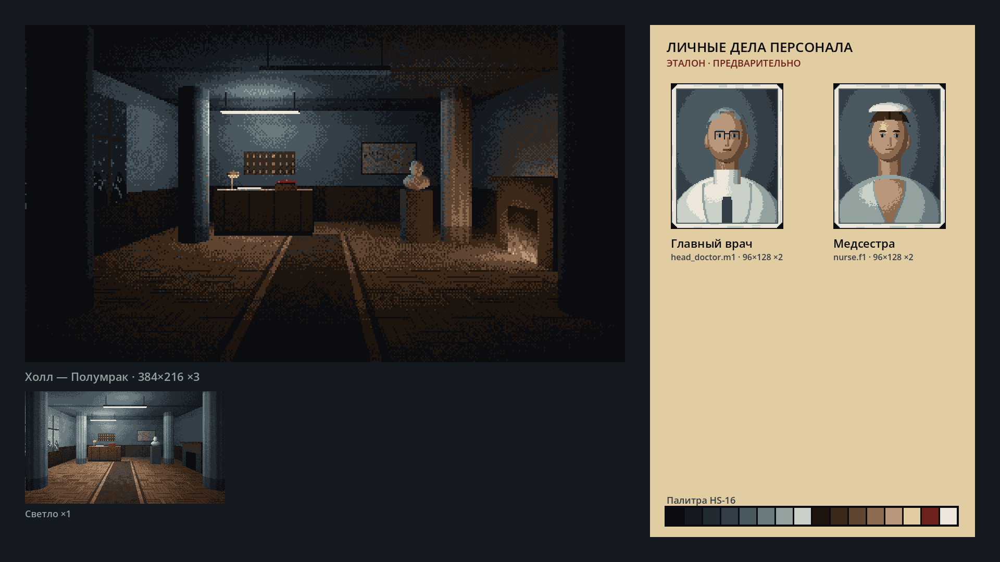
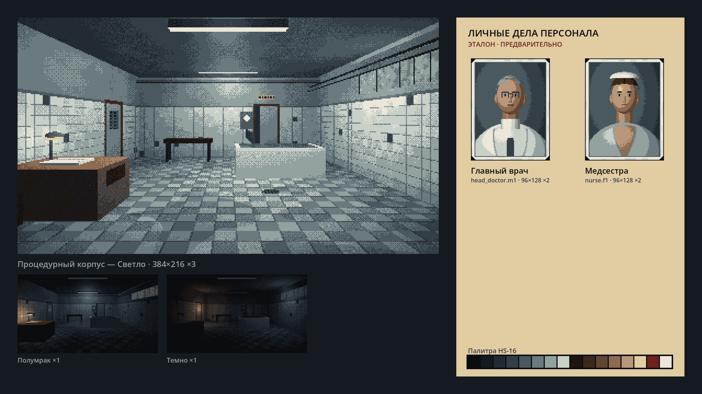
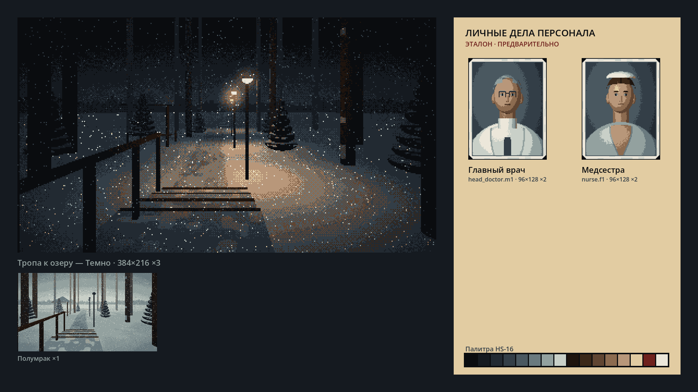

# Арт-направление и пайплайн ассетов

> **Статус: утверждён владельцем для сценария технодемо.** Документ подготовлен в задаче
> [CNT-010](../../tasks/CNT-010.md). Источник финального арта и лицензионная политика остаются
> открытыми в [OQ-08](../planning/open-questions.md).
> Все ассеты в `apps/desktop/assets/art` на сегодня — **прототипы** (`status: "prototype"`).

Документ задаёт визуальный стиль статичных иллюстраций (локации, портреты, рамки досье) и
воспроизводимый путь от исходника до текстуры в Godot. Тон — [game-design.md §8](game-design.md);
сеттинг — [mvp-scenario-sanatorium.md](mvp-scenario-sanatorium.md); экран — [godot-client.md
§4.1](../desktop/godot-client.md).

## 1. Коротко

| Решение (предварительное) | Значение |
|---------------------------|----------|
| Стиль | «Казённая зима»: мрачные статичные иллюстрации, мотивированный свет, аналоговая фактура |
| Палитра | HS-16: 16 цветов — холодная рампа (8), тёплая рампа (6), акцент «ржавчина», «бумага» |
| Дизеринг | упорядоченный Bayer 4×4, двухцветный; без диффузии ошибки |
| Локация | 384×216 (16:9), на экране ×3 = 1152×648; вариант на каждый уровень освещения |
| Портрет | 96×128 (3:4), на экране ×2 или ×3; «фото из личного дела» в рамке 9-slice |
| Импорт | PNG 8 бит, Lossless, без mipmaps, фильтрация Nearest, только целые масштабы |
| Проверка | `npm run art:check`, GUT `test_art_assets.gd`, сцена `tests/manual/art_preview.tscn` |
| Происхождение | `assets/art/provenance.json`: запись и `sha256` на каждый файл |

## 2. Визуальная стилистика

**Концепция — «казённая зима».** Советская здравница, доживающая в 2026 году: лампы дневного
света, паркет и кафель семидесятых, метель за окном. Картинка — неподвижная, как кадр с плохой
плёнки или фото из архивной папки. Ужас — в тишине, пустоте и неправильном свете, а не в
натурализме.

Почему так:

1. **Статичные иллюстрации** — решение [vision.md](../vision/vision.md) («не открытый 3D-мир»).
   Низкое разрешение и ограниченная палитра делают их дешёвыми в производстве и однородными
   при разных авторах.
2. **Ограниченная палитра и дизеринг** заданы [game-design.md §8](game-design.md). Они же дают
   «аналоговую» фактуру современного сеттинга (OQ-12) без ретро-стилизации эпохи: предметы в
   кадре современные или советские, а фактура — от старой печати.
3. **Мотивированный свет.** Каждое пятно света имеет источник в кадре (лампа, окно, огонь,
   фонарь). Это делает уровни освещения из данных (`lighting: bright|dim|dark`) осмысленными:
   ночью гаснет конкретная лампа, а не «темнеет картинка».
4. **Читаемость прежде атмосферы.** Игрок решает логическую задачу; иллюстрация не должна
   прятать то, что уже перечислено в интерфейсе (раздел 5.3).

Источники вдохновения — по настроению (мрачные хоррор-адвенчуры с ограниченной палитрой,
советская архитектура санаториев, фотографии из личных дел). Мы **не копируем** конкретные игры,
кадры или стиль конкретного художника и сознательно уходим от однобитной манга-графики
World of Horror: у нас полутона, перспектива и цвет ([vision.md](../vision/vision.md)).

Не делаем: пиксельную анимацию персонажей, кровь и тела в фоновых иллюстрациях, яркие
насыщенные цвета, сглаживание (anti-aliasing) с цветами вне палитры, градиенты без дизеринга.

## 3. Палитра HS-16

Источник истины — [`apps/desktop/assets/art/palette/hs16.gpl`](../../apps/desktop/assets/art/palette/hs16.gpl)
(формат GIMP; открывается в Aseprite, Krita, GIMP, Photoshop через плагины). Порядок цветов —
порядок индексов во всех PNG.

| # | Имя | Hex | Роль |
|---|-----|-----|------|
| 0 | C0 ink | `#0a0c0f` | самая тёмная тень, чернила интерфейса |
| 1 | C1 night | `#151a20` | ночное небо, стол-подложка досье |
| 2 | C2 shadow | `#222a32` | тени холодного света |
| 3 | C3 slate | `#333e47` | полутень, вторичные чернила |
| 4 | C4 concrete | `#4a5860` | стены, бетон, металл |
| 5 | C5 fog | `#6a7a7f` | туман, штукатурка, затёртый кафель |
| 6 | C6 fluorescent | `#93a19f` | свет ламп дневного света, приглушённый текст |
| 7 | C7 snow | `#c9d0c8` | снег, белый кафель, халаты |
| 8 | W0 soot | `#1e140e` | тёплая глубокая тень, сажа |
| 9 | W1 walnut | `#3b2819` | дерево мебели, волосы |
| 10 | W2 parquet | `#604532` | паркет, кожа в тени |
| 11 | W3 brass | `#8c6b50` | латунь, кожа |
| 12 | W4 lamp | `#b8977a` | свет ламп накаливания, светлая кожа |
| 13 | W5 filament | `#e2cca2` | нить накала, пламя, бумага досье |
| 14 | A0 rust | `#6f211d` | **зарезервированный акцент** |
| 15 | A1 paper | `#ece7da` | блики, снежинки, белая бумага |

Правила:

- **Две рампы — два вида света.** Холодная (C0–C7) — люминесцентные лампы, снег, луна; тёплая
  (W0–W5) — лампы накаливания, огонь, дерево, кожа. Конфликт холодного и тёплого света — главный
  приём композиции. Тёплая рампа приглушена (низкая насыщенность), чтобы кожа и паркет не
  становились «оранжевыми».
- **A0 «ржавчина» — только нарративный акцент:** предмет, к которому стоит присмотреться
  (телефон без гудка в холле), и штамп в интерфейсе. Не больше 3 % пикселей кадра (проверяется);
  квантователь использует A0 только в пикселях, отмеченных маской акцента (раздел 7.3).
  Красный не означает «улика» или «виновник» — это декоративный приём, а не подсказка.
- **A1 «бумага»** — самые яркие точки кадра: блики, снег у фонаря, белая бумага.
- Интерфейс досье использует те же цвета (раздел 6.3). Эффекты рассудка и Static
  ([GDT-010](../../tasks/GDT-010.md)) рисуются шейдером поверх и палитрой не ограничены.

## 4. Свет, контраст, дизеринг

**Уровни освещения.** Для каждой локации данные задают `lighting` по периодам суток
(`content/scenarios/*/locations.json`). Иллюстрация существует в каждом используемом уровне
(раздел 7.2); геометрия кадра во всех вариантах одинакова, меняется только свет:

| Уровень | Что в кадре | Ориентир по тону |
|---------|-------------|------------------|
| `bright` | горят основные источники, окно даёт дневной свет; тени холодные | большая часть кадра в C3–C7 / W2–W4 |
| `dim` | один-два источника (одна лампа, огонь, настольная лампа); углы уходят в C0–C2 | ≈ половина кадра в C0–C2 |
| `dark` | только случайный свет (луна в окне, свет из соседней комнаты, фонари) | большая часть кадра в C0–C2; силуэты читаются |

**Контраст и читаемость.** В любом варианте каждая точка интереса локации (`hotspots`) видна хотя
бы силуэтом на фоне со сдвигом не меньше двух ступеней рампы. Если сюжетно света нет, его
добавляют мотивированно: свет из окна дежурной, огонёк лампы, отражение снега. Самые яркие
пятна кадра (A1, W5, C7) — не больше двух-трёх зон, иначе глаз не находит центр.

**Дизеринг — упорядоченный Bayer 4×4, двухцветный.** Для каждого пикселя выбирается пара цветов
палитры, смесь которых ближе всего к нужному тону, и порог матрицы Байера решает, какой из двух
поставить. Почему не диффузия ошибки (Floyd–Steinberg):

- узор стабилен: один и тот же пиксель в вариантах `bright`/`dim`/`dark` не «шевелится», переход
  между вариантами затемнением не мерцает;
- регулярная сетка — узнаваемая «печатная» фактура, а не шум;
- PNG с упорядоченным узором сжимается заметно лучше.

Штраф за смешивание далёких цветов (`pairPenalty`) не даёт изображать серый смесью чёрного и
белого. Для портретов штраф выше (0,9 против 0,35): лица читаются лучше крупными пятнами.
Зерно — только как пиксели палитры (слабый детерминированный шум до квантования); виньетка
затемняет углы кадра.

## 5. Локации

### 5.1. Разрешение и пропорции

- Пластина локации — **384×216** пикселей, 16:9.
- В Exploration пластина показывается **×3 = 1152×648** при базовом окне 1920×1080 (справа
  остаётся колонка ≈ 700 px под досье, действия и выходы). Полноэкранный показ (вступление,
  концовки) — ×5 = 1920×1080 ровно; при 4K — ×10.
- Почему 384×216: это наибольший размер, который даёт целые масштабы и для колонки Exploration
  (×3), и для полного экрана 1080p и 4K (×5, ×10); детализации хватает на 3–4 точки интереса,
  а объём рисования на кадр остаётся посильным для небольшой команды.

### 5.2. Композиция

- Камера на уровне глаз (≈ 1,55 м), горизонт на 40–45 % высоты кадра, одна точка схода или
  мягкая двухточечная перспектива. Взгляд — с порога: игрок «входит» в локацию.
- Точки интереса — в центральной зоне кадра (≈ 300×170), не у самых краёв: края темнеют
  виньеткой и в будущем могут уйти под оверлеи интерфейса.
- Передний план — рамка (колонны, стволы, перила) в тени; среднего плана — объекты точек интереса;
  дальний — источник света или выход.

### 5.3. Что нельзя рисовать в пластине

Пластина — **постоянное окружение**, общее для всех seed. В ней запрещено всё, что зависит от
сгенерированной истины или симуляции, иначе картинка раскроет то, чего игрок не знает
([AGENTS.md §3](../../AGENTS.md), правила 1 и 2):

- тела, кровь, следы, улики, переставленные или пропавшие предметы;
- персонажи (они — отдельный слой интерфейса из `presentCharacters`);
- надписи с именами, датами и временем.

Точки интереса из `locations.json` рисуются всегда, но иллюстрация не заставляет искать их
пиксель за пикселем: интерфейс перечисляет их списком. Состояние «осмотрено» показывает
интерфейс, а не картинка.

## 6. Портреты и рамки

### 6.1. Разрешение и показ

- Портрет — **96×128** пикселей, 3:4, без рамки, на всю площадь.
- Масштаб показа: ×2 (192×256) — карточка досье и доска дела, ×3 (288×384) — диалог.
  Миниатюры (список персонажей в Exploration) — отдельно нарисованный кроп лица, если
  понадобится; уменьшать дизеринг-арт нельзя.

### 6.2. «Фото из личного дела»

Все портреты снимаются одним «фотоаппаратом»:

- анфас, плечи уходят за края кадра, линия глаз на ≈ 35 % высоты, голова ≈ 40 % ширины;
- один и тот же фон (ровная серо-синяя стена C4→C3), один и тот же свет: ключевой холодный
  сверху-слева, слабый тёплый заполняющий спереди, контровой сзади-справа; тени кожи уходят в
  тёплую рампу (иначе на 96×128 они читаются как щетина);
- **нейтральное выражение лица.** Виновником может стать любой персонаж
  ([investigation-model.md §1](../investigation/investigation-model.md)), поэтому портрет не
  несёт признаков вины, угрозы или «подозрительности»: ни мимикой, ни светом, ни цветом.
  Внешнее состояние (`demeanor`) показывает интерфейс текстом.

Варианты внешности — по архетипу: `<archetype>.<variant>`, где вариант — буква и номер
(`m1`, `f1`): сгенерированные персонажи одного архетипа бывают разного пола и возраста
(пулы имён в `archetypes.json`). Выбор варианта для персонажа — задача
[ENG-008](../../tasks/ENG-008.md).

### 6.3. Рамка и совместимость с досье

- Рамку рисует интерфейс, а не портрет: [`ui/frames/photo_frame.png`](../../apps/desktop/assets/art/ui/frames/photo_frame.png)
  — 24×24, `NinePatchRect` с полями 6 px, `draw_center = false`, тот же масштаб, что у портрета.
  Бумажное поле с чёрными фотоуголками — как фотография, вклеенная в папку.
- Токены интерфейса досье (все из HS-16):

| Токен | Цвет | Использование |
|-------|------|---------------|
| стол | C1 `#151a20` | фон экрана вокруг пластины и карточек |
| бумага | W5 `#e2cca2` | карточки досье, доска дела |
| чернила | C0 `#0a0c0f` | основной текст на бумаге |
| чернила-2 | C3 `#333e47` | вторичный текст, линейки |
| штамп | A0 `#6f211d` | пометки «секретно», статусы; не для улик и подсказок |
| приглушённый | C6 `#93a19f` | подписи на тёмном фоне |

- Раскладка, проверенная в предпросмотре: пластина ×3 слева (48, 48), карточка досье справа
  шириной 624 px; на бумаге портреты ×2 в рамках. Шрифты интерфейса в этот документ не входят.

## 7. Пайплайн ассетов

### 7.1. Форматы

| Что | Формат | Где |
|-----|--------|-----|
| Ассет в игре | PNG, 8 бит/канал, без interlace; индексированный (палитра HS-16) или RGBA только с альфой 0/255 | `apps/desktop/assets/art/…` |
| Палитра | GIMP `.gpl` | `assets/art/palette/hs16.gpl` |
| Исходник художника (`.aseprite`, `.kra`, `.psd`) | формат редактора | вне репозитория до решения о хранении (раздел 10, вопрос 5) |
| Процедурный исходник | код генератора | `tools/art/reference/` |

JPEG, WebP, полупрозрачность, цветовые профили и 16 бит не используются: они ломают точное
совпадение с палитрой.

### 7.2. Структура и именование

```
apps/desktop/assets/art/
├── provenance.json                                 — реестр происхождения (§7.5)
├── palette/hs16.gpl                                — палитра HS-16
├── scenarios/<scenario>/
│   ├── locations/<location_id>.<lighting>.png      — 384×216, непрозрачный
│   └── portraits/<archetype_id>.<variant>.png      — 96×128, непрозрачный
└── ui/
    ├── frames/<name>.png                           — рамки 9-slice, ≤ 64×64
    └── icons/<name>.png                            — значки, ≤ 64×64
```

- Имена — `snake_case` латиницей; `<scenario>`, `<location_id>`, `<archetype_id>` — id из
  `content/scenarios/<scenario>/` (например, `loc_hall`, `head_doctor`).
- `<lighting>` — `bright`, `dim` или `dark`. Если у локации есть хотя бы одна пластина, должны
  быть пластины для **всех** уровней, которые встречаются в её `lighting`, и ни для каких других.
- `<variant>` — буква и цифра: `m1`, `f1`, `f2`.
- Ссылка на портрет в протоколе (`CharacterView.portraitRef`, `PhoneView.contacts[].portraitRef`)
  — `<archetype_id>.<variant>`; путь клиент собирает сам из сценария сессии. Пустая строка —
  портрета нет, интерфейс показывает силуэт-заглушку.

### 7.3. Подготовка исходника

1. Рисовать **в целевом разрешении** (384×216 или 96×128) с палитрой HS-16 — предпочтительно.
   Рисовать крупно и уменьшать нельзя: уменьшение дизеринга даёт грязь.
2. Если исходник в RGB (живопись, фото-референс как подмалёвок, процедурный рендер) —
   квантование в HS-16:

   ```bash
   node tools/art/quantize.mjs master.png out.png [--dither bayer4|none] [--accent-mask mask.png]
   ```

   Без маски акцент A0 не используется; белые пиксели маски (того же размера) разрешают A0.
   Прозрачные пиксели во входе отклоняются.
3. Проверить картинку на экране в масштабе показа (раздел 9), а не в редакторе с увеличением.

### 7.4. Импорт в Godot

- Файл `<name>.png.import` создаёт Godot при импорте; он **коммитится** вместе с PNG (каталог
  `.godot/` — нет). Обязательные параметры (проверяет `art:check`): `importer="texture"`,
  `compress/mode=0` (Lossless), `mipmaps/generate=false`, `process/size_limit=0`,
  `detect_3d/compress_to=0` (иначе Godot может пережать текстуру в VRAM-формат при
  использовании в 3D).
- **Фильтрация — Nearest.** В Godot 4 это свойство узла: `texture_filter =
  TEXTURE_FILTER_NEAREST` у узла, показывающего арт, или у его родителя (дети наследуют
  `PARENT_NODE`). Глобальный параметр проекта не меняем: он затронул бы шрифты интерфейса.
- **Только целые масштабы:** `scale = Vector2(3, 3)` у `TextureRect` или контейнера.
  `stretch_mode = canvas_items` при окне, не кратном 1920×1080 (например, 2560×1440),
  даёт дробный масштаб и неравные пиксели. `display/window/stretch/scale_mode = "integer"`
  рассмотрен и отклонён в [GDT-012](../../tasks/GDT-012.md): окна меньше 1920×1080 обрезаются
  ([godot-client.md §4.1](../desktop/godot-client.md)); ровные пиксели — при 1080p, 1440p и 4K.
- **Атласы.** Пластины и портреты — отдельные текстуры без атласа: их немного на экране, они
  грузятся по требованию, а GL Compatibility не теряет на них батчинг. Для наборов значков (> 10
  файлов) использовать встроенный импортёр Godot «Texture Atlas» (`importer="texture_atlas"`)
  без сторонних упаковщиков; значки в одном атласе — один каталог `ui/icons/<set>/`.
- **Память.** Пластина в VRAM — 384×216×4 ≈ 324 КБ; полный набор MVP (12 локаций,
  29 пластин по фактическим уровням `lighting`) ≈ 9 МБ; портрет ≈ 48 КБ. Загрузка — по требованию
  экрана (`ResourceLoader.load_threaded_request`) через `src/ui/art_library.gd`; в кэше — только
  текущая локация, локации её выходов и портреты на экране (GDT-012).

### 7.5. Происхождение и лицензии

Каждый PNG в `assets/art` имеет запись в [`provenance.json`](../../apps/desktop/assets/art/provenance.json):

| Поле | Значение |
|------|----------|
| `path` | путь от `assets/art/` |
| `kind` | `location`, `portrait`, `ui` |
| `status` | `prototype` или `final` |
| `origin` | `procedural` (код), `hand` (нарисовано в проекте), `commissioned` (заказ), `stock` (сторонний сток или пак), `generative` (модель генерации изображений) |
| `author` | кто создал файл |
| `tool` | инструмент или скрипт |
| `sources` | сторонние материалы: `url`, `license`, `author`; обязательно для `stock` и `commissioned` |
| `license` | `project-internal` (создано для проекта, права у владельца; лицензия проекта — OQ-02), SPDX-идентификатор (`CC0-1.0`, …) или `pending` |
| `created` | дата |
| `notes` | что изображено, статус |
| `sha256` | хэш файла: запись относится к конкретной версии |

Правила до решения OQ-08:

- Не добавлять изображения без подтверждённого права использования. Скриншоты чужих игр,
  картинки из поиска, «референсы» в итоговом ассете — запрещены.
- `final` нельзя поставить при `license: pending`; финальный статус выставляется только после
  решения владельца по OQ-08.
- Атрибуция `CC-BY-*` попадает в титры; лицензии с запретом коммерческого использования
  (`-NC`) или изменения (`-ND`) непригодны для ассетов, которые мы квантуем и правим.
- Значение `origin: generative` описано, чтобы честно маркировать такие файлы, но допустимость
  генеративных изображений в проекте — решение владельца (раздел 10).

### 7.6. Проверки

| Проверка | Что проверяет | Когда |
|----------|---------------|-------|
| `npm run art:check` (`tools/art/check-art.mjs`) | имя и категория, id сценария, локации, архетипа и уровня освещения; полнота вариантов освещения; размер; все пиксели в HS-16; альфа 0/255; непрозрачность пластин и портретов; доля A0 ≤ 3 %; параметры `.import`; запись в `provenance.json`, обязательные поля, `sources` для стоков и заказов, свежесть `sha256` | локально перед PR; в CI — тестом `tools/art/check-art.test.ts` в `npm test` |
| GUT `tests/unit/test_art_assets.gd` | каждый ассет из реестра грузится как `Texture2D`, без mipmaps и сжатия, размер категории; в наборе ≥ 3 локаций и ≥ 2 портретов | `npm run test:godot` |
| Визуальная проверка | масштаб показа, читаемость точек интереса в каждом варианте освещения, единообразие портретов | `tests/manual/art_preview.tscn` (раздел 9) |

## 8. Эталонные ассеты (прототипы)

Три локации MVP-сценария в каждом их уровне освещения, два портрета и рамка. Все — **оригинальные
процедурные прототипы**: нарисованы кодом `tools/art/reference/` (простой растеризатор с
перспективой, освещением и квантованием в HS-16), без сторонних изображений, фотографий и
моделей генерации изображений. Код написан AI-агентом в задаче CNT-010; `origin: procedural`,
`license: project-internal`, `status: prototype`.

| Файл | Что показывает |
|------|----------------|
| `locations/loc_hall.bright.png`, `.dim.png` | Холл: колонны, паркет, стойка с телефоном (акцент A0), камин, бюст, карта маршрутов; днём — две лампы и окно, вечером — одна лампа, настольная лампа и камин |
| `locations/loc_treatment.bright.png`, `.dim.png`, `.dark.png` | Процедурный корпус: кафель, ванна подводного массажа, пост медсестры, двери ЛФК и дежурной; ночью — только луна в окне и свет из дежурной |
| `locations/loc_lake_path.dim.png`, `.dark.png` | Тропа к озеру: сосны, ели, обледенелые ступени, беседка, фонари (один не горит), мостки, «белая тишина» |
| `portraits/head_doctor.m1.png` | Главный врач: седой мужчина в очках, халат, галстук |
| `portraits/nurse.f1.png` | Медсестра: женщина, собранные волосы, медицинская шапочка, форма |
| `ui/frames/photo_frame.png` | рамка фотографии досье, 9-slice |

Повторная генерация даёт байт-в-байт те же файлы и обновляет `sha256` в реестре:

```bash
npm run art:reference                       # все эталоны
node tools/art/reference/render.mjs --only loc_hall --preview <каталог>   # ×3 копии для просмотра
```

Ограничения прототипов: геометрия упрощена (боксы, цилиндры, эллипсоиды), лица схематичны,
нет фактур ручной работы. Они фиксируют **правила** — масштаб, палитру, свет, дизеринг,
композицию и рамку, — а не художественное качество финала.

## 9. Визуальная проверка в Godot

`apps/desktop/tests/manual/art_preview.tscn` показывает пластину ×3 с фильтрацией Nearest,
остальные варианты освещения той же локации ×1, карточку досье с портретами ×2 в рамке и
палитру. Запуск из редактора (F6, стрелки ←/→ переключают пластину) или:

```bash
godot --path apps/desktop res://tests/manual/art_preview.tscn -- --plate=loc_hall.dim
godot --path apps/desktop res://tests/manual/art_preview.tscn -- --plate=loc_hall.dim --capture=out.png
```

С `--capture` кадр 1920×1080 рендерится в `SubViewport` фиксированного размера (не зависит от
окна), сохраняется и сцена закрывается. Кадры Godot 4.7.2 (GL Compatibility):







## 10. Источник финального арта — рекомендация к OQ-08

Вопрос открыт: решение принимает владелец. Ниже — варианты и рекомендация агента.

| Вариант | Плюсы | Ограничения и риски |
|---------|-------|---------------------|
| **А. Заказ художнику** (договор с передачей исключительных прав или исключительной лицензией) | ясные права; единый авторский стиль по этому документу; приемлемо для магазинов | бюджет и сроки; нужен договор; объём MVP — 29 пластин и ≈ 18 портретов (9 архетипов × 2 варианта) |
| **Б. Собственный арт команды** (ручной пиксель-арт или процедурный, как эталоны) | права у проекта; бесплатно; воспроизводимо | качество ограничено навыками команды; процедурный способ слаб для лиц и органики |
| **В. Модели генерации изображений** + ручная доработка и квантование | быстро; дёшево для черновиков | неясный статус авторских прав на результат и на обучающие данные; магазины требуют раскрывать использование ИИ-контента (Steam — с 2024 г.); трудно выдержать единый стиль и точную палитру; репутационный риск в жанровом сообществе |
| **Г. Стоки и паки** (CC0 или коммерческие лицензии) | дёшево; годится для фактур и мелочей | стиль не совпадает с HS-16; учёт лицензий и атрибуции; уникальных локаций санатория в стоках нет; запрещены NC/ND |

**Рекомендация.** Финальные пластины и портреты — **А** (заказ) по этому стайлгайду; прототипы
и служебная графика — **Б**; **Г** — только CC0 или лицензии, разрешающие изменение и
коммерческое использование, и только для вспомогательных фактур, с записью в `provenance.json`;
**В** — не использовать в поставляемых ассетах, допускать только для внутренних мудбордов
вне репозитория. Та же политика логично применяется к звуку ([CNT-011](../../tasks/CNT-011.md)).

**Вопросы владельцу для согласования (OQ-08):**

1. Утверждаете ли вы предварительный стиль: HS-16, дизеринг Bayer 4×4, пластина 384×216 ×3,
   портрет 96×128 «фото из личного дела»?
2. Источник финальных пластин и портретов: заказ художнику (А), собственными силами (Б) или
   иначе? Если А — с передачей исключительных прав или по исключительной лицензии?
3. Допускаются ли генеративные модели изображений: (а) нигде, (б) только для внутренних
   черновиков вне репозитория, (в) в поставляемых ассетах с раскрытием?
4. Какие сторонние лицензии допустимы: только CC0; CC0 и CC-BY (с титрами); коммерческие
   лицензии стоков?
5. Где хранить исходники художника (`.aseprite`, `.kra`, `.psd`): в этом репозитории через
   Git LFS, в отдельном хранилище или не хранить?

## 11. Ограничения и дальнейшие задачи

- Документ и HS-16 утверждены для технодемо; если палитра изменится для финального арта, тогда
  эталоны перегенерируются (`npm run art:reference`).
- Exploration показывает пластины и портреты ([GDT-012](../../tasks/GDT-012.md),
  [godot-client.md §4.1](../desktop/godot-client.md)); без арта — плейсхолдер и силуэт.
- `portraitRef` в представлениях пока пустой; выбор варианта портрета персонажа —
  [ENG-008](../../tasks/ENG-008.md).
- Полный набор арта `sanatorium_winter` — [CNT-012](../../tasks/CNT-012.md), после решения OQ-08.
- Шрифты интерфейса, анимация, звук (CNT-011) и мобильное приложение этим документом не
  регулируются.
